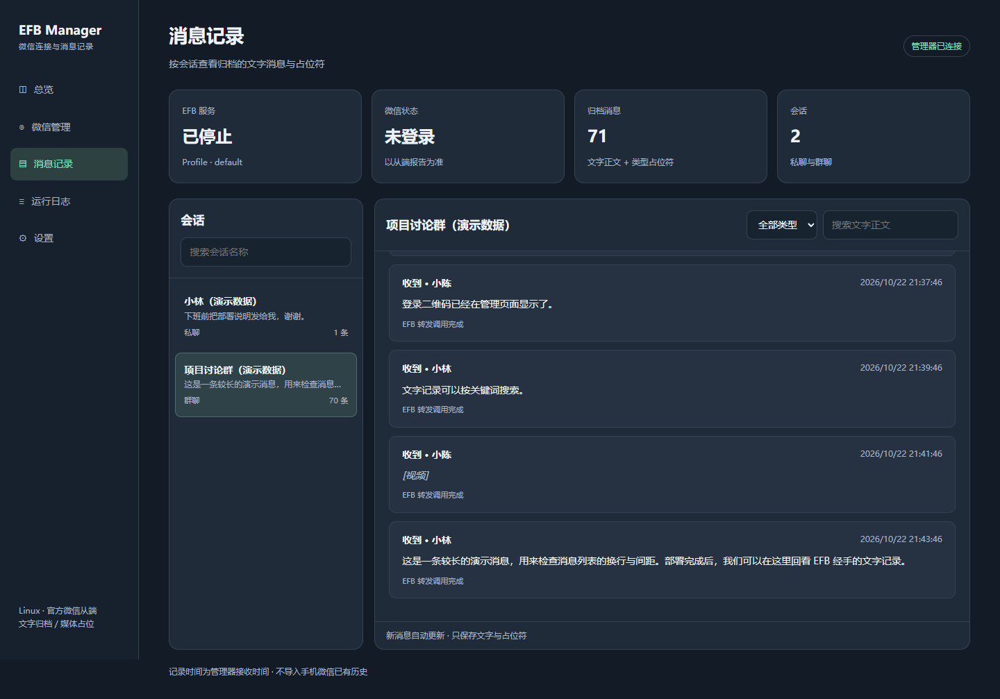

# EFB Manager（Linux，v0.3.0）

独立运行的本机 Web 管理器，接管一个官方 `efb-wechat-slave` 实例。

支持主动登录、主动退出、二维码刷新、登录时间、本次持续在线时长、上次在线时长、EFB 启动/停止/重启以及最近 250 行日志。主动退出后不自动重新登录。页面关闭或刷新不影响计时。

新增消息记录页：左侧会话列表，右侧按时间查看消息；支持会话名称搜索、文字正文搜索、消息类型筛选、自动更新和加载更早记录。查看更早记录时暂停自动更新，可点击“回到最新”恢复。桌面使用侧栏，手机窄屏改为上下布局。

## 快速部署（已有 EFB 的 Linux 主机）

前提：已有正常工作的 EFB、官方 `efb-wechat-slave` 和 Telegram 主端配置，Python 3.9+。管理器需与 EFB 使用同一个 Linux 用户、Python 解释器和配置目录；虚拟环境不是必需条件。**当前版本尚未完成真实 Linux 微信账号扫码与收发验收。**

先停止原先运行的 EFB，避免同一个 profile 被两个进程同时使用。如果原 EFB 是系统安装，可直接从源码运行，不需要新建虚拟环境，也不需要向系统 Python 安装管理器。以下 `python3` 必须指向原 EFB 使用的解释器（如有不同，请替换为其绝对路径）：

```bash
git clone https://github.com/chern91552/efb-manager.git
cd efb-manager
python3 -m efb_manager.server --profile default --port 8765
```

原 EFB 已使用虚拟环境时，也可以激活原环境后运行上述源码命令，或执行 `python -m pip install .` 安装管理器。不要为了管理器迁移现有 EFB。

在同一台 Linux 主机的另一个终端读取管理口令：

```bash
cat ~/.local/state/efb-manager/access-token
```

本机浏览器打开 [http://127.0.0.1:8765](http://127.0.0.1:8765)，输入口令，进入“微信管理”，依次点击“启动 EFB”和“登录微信”，再使用手机微信扫码并确认。

远程 Linux 服务器：在自己的电脑上执行 SSH 转发，保持该终端连接，再访问上面的本机地址：

```bash
ssh -N -L 8765:127.0.0.1:8765 YOUR_USER@YOUR_SERVER
```

无需开放服务器的 8765 公网端口。首次启动管理器不会自动启动 EFB 或登录微信。

**[完整部署指南：环境检查、systemd 开机启动、数据备份、升级回退与常见问题](deploy/README.zh-CN.md)**

## 消息分类与容量上限

在“设置 → 消息保存设置”中，可独立开启或关闭私聊、群聊、公众号消息的归档。默认保存私聊和群聊，不保存公众号消息；关闭只影响新归档，不影响微信或 Telegram 转发，也不会按类别删除已有记录。旧版本已经保存的记录不会重新识别为公众号。

消息库容量上限默认 100 MiB，可设置 1 到 10240 MiB。超限后后台从归档时间最早的记录开始分批删除，通常清理至上限约 85%，并压缩数据库、截断 WAL，实际回收空间。主数据库和 WAL/SHM 一并计入使用量；清理每约 2 秒检查一次，写入和压缩过程中可能短暂超限，数据库繁忙时会自动重试。单条记录本身大于上限时也可能被清理。

页面显示当前磁盘占用及累计清理条数。该上限作用于同一 state 目录内的整个消息库，包含其他 profile 的记录；不限制原 EFB 的媒体缓存、运行日志或备份。缩小上限会触发自动清理，删除的历史不可恢复。设置即时生效并跨重启保存，无需重启 EFB。

## 自定义管理口令

登录后，进入“设置 → 修改管理口令”，填写当前口令、新口令和确认口令即可。支持 8 到 256 个字符，不能包含控制字符或首尾空白。保存后立即生效，当前浏览器保持登录，其他浏览器或设备的旧登录会话失效；EFB 和微信会话继续运行。

首次部署或忘记口令时，也可以在项目目录使用原 EFB 的 Python 交互设置（将 `python3` 替换为原解释器路径）：

```bash
python3 -m efb_manager.server --set-password
```

命令会隐藏输入、要求确认两次，设置完成后退出，不启动 EFB。若管理器服务正在运行，命令行设置后需要 `sudo systemctl restart efb-manager` 生效；该重启会停止其 EFB 子进程，之后需在页面重新启动。已有口令文件继续兼容，不会因更新自动重置。

口令仍保存于实际 `--state-dir` 下的 `access-token` 文件，Linux 下仅运行用户可读写。修改口令和服务启动必须使用相同用户与数据目录；未自定义数据目录时默认使用 `~/.local/state/efb-manager`。不要把真实口令写进命令参数、服务文件或 Git 仓库。

## 界面预览

以下使用模拟会话与消息，不包含真实微信账号数据。



[查看手机窄屏预览](assets/mobile-demo.png)

[查看归档与口令设置页](assets/settings-demo.png)

## 消息保留规则

- `Text` 消息保存完整文字正文，文字中的网址正常保留。
- 图片、表情、语音、视频、文件、链接卡片、位置等只保存 `[图片]`、`[表情]` 等类型占位符。未知类型显示 `[其他消息]`。不保存其说明文字、文件名、链接、缩略图或附件内容。
- 所有记录保留会话名称、发送者、收发方向、EFB 消息 ID 和归档时间；归档时间是管理器观察到消息的时间，不是手机原始发送时间。
- 数据库位于 `~/.local/state/efb-manager/messages.sqlite3`，可通过 `--state-dir` 修改。不同 EFB profile 的记录隔离，同一 profile 内按通道与会话 ID 区分。该版本不按微信登录身份创建独立档案，若需要换号并隔离历史，请使用不同 profile。
- 管理器归档模块不会打开、复制或下载媒体文件；原 EFB/微信从端为了 Telegram 转发而进行的媒体下载仍按上游行为执行。
- 记录从接入后开始，只覆盖经过 EFB 消息分发入口的微信消息，不读取手机数据库、不导入已有历史，也不保证补回停机期间的消息。
- 消息库在 EFB 停止、管理器重启后仍保留。不包含历史撤回/编辑操作的完整审计轨迹，现有消息 ID 重复时更新该条记录。
- 归档在中间件处理前提取，因此保留的是 EFB 分发入口处的文字。消息可能随后被改写、过滤或转发失败；界面的处理结果来自 EFB 调用返回，不代表微信或 Telegram 的已读回执。
- 当前不提供网页发消息、附件下载、手动按类别删除历史和中间件管理；支持按容量自动清理。

备份时请先停止管理器，再备份整个 state 目录（SQLite WAL 文件也可能存在）。口令和聊天记录均在本机保存，目录应仅由运行用户访问。演示截图中的会话与记录是模拟数据，不会随安装包写入你的数据库。

## 安装到现有 EFB 环境

必须使用已经能运行 EFB 的同一个 Python 解释器、Linux 用户、HOME 和配置目录。原来未使用虚拟环境时，无需创建虚拟环境。管理器支持 Python 3.9+；不要为了管理器直接升级现有 EFB 的依赖。先记录版本并备份现有 profile。当前未在真实 Linux 微信账号上联调。

在解压后的项目目录可以直接运行源码（替换为原 EFB 解释器的实际路径）：

```bash
/path/to/python3 -m efb_manager.server --profile default
```

先停止原先运行的 EFB 进程或服务，避免两个实例同时操作同一个 profile。本管理器只控制自己启动的 EFB，不接管外部已运行进程。管理器启动后不自动启动 EFB，也不自动登录微信；在页面依次点击“启动 EFB”和“登录微信”。首次认证期间 EFB 可能尚未完成其他通道初始化。

首次启动生成随机管理口令，读取：

```bash
cat ~/.local/state/efb-manager/access-token
```

本机浏览器打开 `http://127.0.0.1:8765`，输入口令。不要把口令放在网址中。

如果 EFB 在远程服务器，通过 SSH 转发访问：

```bash
ssh -L 8765:127.0.0.1:8765 YOUR_USER@YOUR_SERVER
```

然后在电脑浏览器打开 `http://127.0.0.1:8765`。默认仅绑定回环地址，未提供公网监听或反向代理部署支持。日志可能含聊天内容，请只在自己的设备访问。

## 开机运行

源码运行时使用 `deploy/efb-manager-source.service.example`；已安装管理器时使用 `deploy/efb-manager.service.example`。编辑用户、工作目录和 Python 或管理器的绝对路径，按现有部署补充 `EFB_DATA_PATH` 等环境变量；然后保存为 `/etc/systemd/system/efb-manager.service`：

```bash
sudo systemctl daemon-reload
sudo systemctl enable --now efb-manager
sudo journalctl -u efb-manager -n 50
```

这只启动管理器。EFB 和微信登录仍由页面手动启动。服务用户必须和原 EFB 用户一致，口令也在该用户 HOME 下。

## 行为与限制

- 只退出 EFB 的微信 Web 会话，不退出手机微信。主动退出或掉线后停止计时，下一次登录重新计时。
- 计时从认证及从端基础设置成功后开始；首次生成二维码不算登录成功。暂时断网但从端未报告退出时，界面仍可能显示原状态；这不是微信服务器在线状态的独立探测器。
- 管理器重启会停止其 EFB 子进程；当前会话和上次时长保存在内存，不提供跨服务重启历史。页面连接中断会显示状态未知。
- 登录过程中需要取消时，使用“停止 EFB”。尚未提供独立取消认证按钮。
- 使用安装时找到的 `ehforwarderbot` console entry point，保留 profile 参数；在子进程中适配官方 WeChatChannel 的认证、二维码和退出回调，不改动 site-packages 源文件。未来上游接口变化需要重新验证。
- 当前只支持一个微信实例。中间件管理、配置编辑、自动恢复和累计历史时长未包含在本版。
- 若手机本身无法登录微信网页版，管理器不能改变该限制。

## 本地验证

```bash
python -m unittest discover -s tests -v
```

自动测试使用模拟微信从端验证登录门控、重复登录拒绝、主动退出后保持离线、再次登录和计时。不能代替真实扫码联调。

v0.2.0 增加文字/占位符策略、附件零读取、消息持久化、profile 隔离、去重、分页、查询鉴权和归档失败不打断转发的测试。浏览器验证使用独立演示数据库，检查登录、搜索、类型筛选、更早记录、轮询与手机窄屏。真实 Linux 微信账号收发仍需要部署后验证。

参考上游：
- https://github.com/ehForwarderBot/efb-wechat-slave/blob/master/efb_wechat_slave/__init__.py
- https://github.com/ehForwarderBot/ehForwarderBot

本项目代码以 AGPL-3.0-or-later 发布；EFB 和各通道沿用上游许可。
